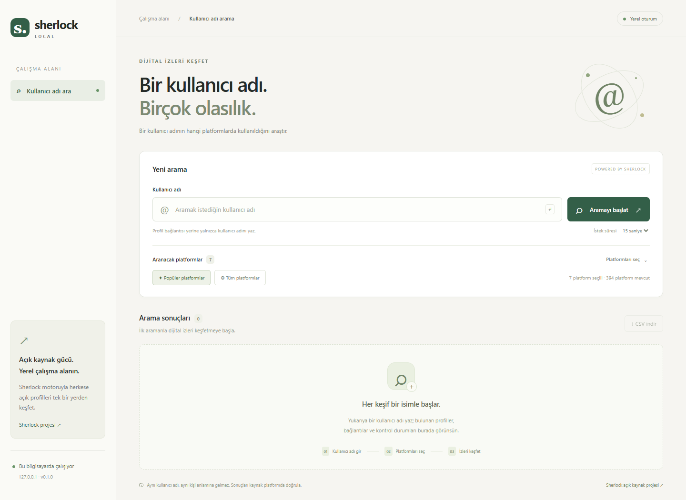

# Sherlock Local

Bilgisayarında çalışan, **Türkçe kullanıcı adı arama uygulaması**. Bir kullanıcı adını platformlar arasında arar, sonuçları tarayıcıda gösterir ve CSV olarak dışa aktarır.



## Sherlock hakkında

Bu uygulamanın arama motoru **[sherlock-project/sherlock](https://github.com/sherlock-project/sherlock)** projesidir. Sherlock Local, Sherlock'un resmi ürünü veya resmi web arayüzü değildir; bağımsız bir yerel arayüzdür. Sherlock kodunu yeniden yazmaz: `sherlock-project==0.16.0` Python paketini ve bu paketle gelen platform tanımlarını kullanır. Sherlock, katkıda bulunanların geliştirdiği **MIT lisanslı** açık kaynak projedir. Atıf ve lisans ayrıntıları [THIRD_PARTY_NOTICES.md](THIRD_PARTY_NOTICES.md) dosyasındadır.

## Özellikler

- Türkçe, mobil ekranlara uyumlu tarayıcı arayüzü.
- Popüler platformlar, tüm platformlar veya tek tek platform seçimi.
- Canlı ilerleme, platform başına durum ve yanıt süresi.
- Bulundu / bulunamadı / kontrol edilemedi filtreleri ve sonuçlarda arama.
- Taramayı gerçekten sonlandıran **Durdur** düğmesi.
- Excel ile uyumlu UTF-8 BOM içeren CSV indirme.
- Aynı tarayıcı sekmesi yenilendiğinde devam eden aramaya geri dönme.
- Yalnızca `127.0.0.1` üzerinde çalışma; veritabanı ve kalıcı arama geçmişi yok.

## Windows'ta başlatma

Ön koşul: **Python 3.10 veya üzeri** ([python.org](https://www.python.org/downloads/)). Python kurulumunda Python launcher veya PATH seçeneğini etkinleştir.

```powershell
git clone https://github.com/muratkorayozkan/sherlock-local.git
cd sherlock-local
.\start.cmd
```

Alternatif olarak klasördeki **start.cmd** dosyasına çift tıkla. İlk çalıştırma proje içinde `.venv` oluşturur ve bağımlılıkları internetten kurar. Sonraki çalıştırmalarda mevcut ortam kullanılır. Tarayıcı otomatik açılır:

**http://127.0.0.1:8765**

Kapatmak için terminalde **Ctrl+C** kullan. Sunucu kapanırken çalışan tarama da durdurulur. PowerShell betiği yürütme kısıtlamaları için `start.cmd`, yalnızca kendi alt sürecinde `ExecutionPolicy Bypass` kullanır; sistem ayarını değiştirmez.

Başka port veya tarayıcı açmadan başlatma:

```powershell
.\start.cmd -Port 8766 -NoBrowser
```

### Elle kurulum / macOS / Linux

```sh
python -m venv .venv
# Windows: .venv\Scripts\activate
# macOS / Linux: source .venv/bin/activate
python -m pip install .
python -m sherlock_local
```

Ortamı yenilemek için uygulama kapalıyken `.venv` içindeki Python ile `python -m pip install --upgrade .` çalıştır. Kaynak klasörün dışında çalıştırmak istiyorsan paketi yeniden kur; geliştirme sırasında `pip install -e ".[dev]"` kullanabilirsin.

## Kullanım

1. Profil URL'si yerine kullanıcı adını yaz. Başındaki `@` işaretini ekleme.
2. Popüler platformları kullan veya **Platformları seç** bölümünden listeyi düzenle.
3. **Aramayı başlat** düğmesine bas. Başka arama başlatmadan önce mevcut aramayı tamamla veya durdur.
4. Sonuçları filtrele, bulunan profil bağlantılarını aç veya CSV indir.

Kullanıcı adı: 1–64 karakter; harf, rakam, alt çizgi, nokta ve tire. İlk karakter harf, rakam veya alt çizgi olmalıdır. Bazı platformların daha dar kuralları vardır; bu durumda sonuç **kontrol edilemedi** olarak görünür.

## Sonuçların anlamı ve sınırlar

- **Bulundu:** Sherlock'un platform tanımına göre profil var görünüyor; kaynakta doğrula.
- **Bulunamadı:** Sherlock bu platformda kullanıcı adı tespit etmedi.
- **Kontrol edilemedi:** Zaman aşımı, ağ hatası, bot engeli veya platforma uygun olmayan ad. Bu durum hesabın bulunmadığı anlamına gelmez.

Aynı kullanıcı adı, hesapların aynı kişiye ait olduğunu kanıtlamaz. Platform değişiklikleri yanlış pozitif veya yanlış negatif üretebilir. Bu sürüm, açılışta dış sunucudan veri indirmek yerine Sherlock **0.16.0 ile paketlenmiş 394 adet yetişkin içerik olarak işaretlenmemiş platform tanımını** kullanır. Tanımlar güncel platform davranışlarından geri kalabilir; Sherlock'un güncel çevrimiçi kataloğu ve dışlama listesi bu sürümde otomatik alınmaz. Paket yükseltmesi entegrasyon testlerinden geçirilmelidir.

Her istek için süre sınırı 3–60 saniye, bütün tarama için 10 dakikadır. Tek seferde bir tarama yürütülür. Tamamlanan/durdurulan son 20 tarama yalnızca bellekte tutulur; uygulama kapanınca silinir. Sekmede yalnızca devam eden aramanın rastgele kimliği `sessionStorage` içinde tutulur. İndirilen CSV dosyaları senin bilgisayarında kalır. Uygulama sorguları platformlara gönderir; platformlar normal ağ isteği bilgilerini görebilir.

## Geliştirme ve test

```sh
python -m pip install -e ".[dev]"
python -m pytest -q
node --check sherlock_local/static/app.js
```

Node.js yalnızca isteğe bağlı JavaScript sözdizimi kontrolü içindir; uygulamayı çalıştırmak için gerekmez. Testler gerçek Sherlock motorunu kontrollü yerel HTTP sunucusuyla doğrular; normal test paketi sosyal ağlara istek göndermez.

### Yapı

| Dosya | İşlev |
| --- | --- |
| `sherlock_local/app.py` | FastAPI, doğrulama ve CSV |
| `sherlock_local/jobs.py` | Alt süreçler, ilerleme, iptal ve bellek sınırı |
| `sherlock_local/worker.py` | Gerçek Sherlock motoru ve JSON satır protokolü |
| `sherlock_local/catalog.py` | Paket içindeki platform tanımları |
| `sherlock_local/static/` | Derleme gerektirmeyen HTML, CSS, JavaScript |

## Lisans

Sherlock Local, [MIT](LICENSE) lisansı altındadır. Sherlock ve diğer bağımlılıkların lisansları kendilerine aittir.
